<picture>
  <source media="(prefers-color-scheme: dark)" srcset="assets/banner-dark.svg">
  <source media="(prefers-color-scheme: light)" srcset="assets/banner-light.svg">
  
</picture>

 

 

&nbsp;&nbsp;

---

## Hi, I'm Uziel

Software engineer in Buenos Aires (UTC−3). For six years I've worked on anti-money-laundering software for banks and fintechs across Latin America: first implementing it, then as technical Product Owner of the .NET product, and since 2025 writing the code: Node/TypeScript microservices, Angular, SQL Server, and Python scrapers for hard public sources.

- 🤖 **Agents behind human gates.** I run my own development flow: a coordinator splits work among AI agents with their own role and model, and anything irreversible (production, data, merges) waits for my OK.
- 🔎 **Root cause, with a number.** A deduplication that silently dropped 63.7% of a file. A rule that never fired over a floating-point rounding error. A daily diff over ~30M records that only processes what's new.
- 🛠️ **End to end.** An AI product in production for a foundation, with its own calculation engine, and its open demo below.
- 💬 Available for remote contract, freelance or part-time work.

## stack

---

## open work

| project | what it is |
|---|---|
| **[Astrolabio](https://github.com/uzi-dev99/golden-matrix-demo)** | The open demo of an AI product running in production: a chart computed on the server, the exact prompt shown and fenced against injection, a streamed report with latency, tokens and cost, and provider fallback. Engine validated against Swiss Ephemeris within ±0.02°. |
| **[An album for two](https://github.com/uzi-dev99/pareja-web-demo)** | Creative frontend: curved photo marquee, a 3D carousel per month and a pixel-art room. Installable PWA, 376 passing tests. |
| **[Portfolio](https://portfolio.wuzi.uk)** | A WebGL world with the rest of my work: the agent flow, my own infrastructure, data at scale and AML in production. |

<code>built with my own agent flow · human gates included</code>

